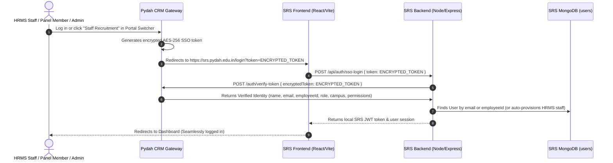

# Staff Recruitment System (SRS) - SSO & Portal Switcher Integration Guide

This guide provides step-by-step instructions for integrating **Single Sign-On (SSO)** and the **Universal Portal Switcher CDN** into the **Staff Recruitment System** (`srs.pydah.edu.in`).

---

## 🏛️ System Architecture



---

## 📦 User Schema Compatibility

The SRS `User` model (`backend/models/User.js`):

```javascript
const userSchema = new mongoose.Schema({
  name: { type: String, required: true, trim: true },
  employeeId: { type: String, trim: true, sparse: true, index: true },
  email: { type: String, required: true, unique: true, lowercase: true, trim: true },
  password: {
    type: String,
    required: function() {
      // HRMS employees authenticate directly against HRMS; no local password required
      return !this.employeeId;
    }
  },
  role: {
    type: String,
    enum: ['super_admin', 'sub_admin', 'panel_member', 'candidate'],
    required: true
  },
  campus: {
    type: String,
    trim: true,
    required: function() {
      return this.role === 'panel_member';
    }
  },
  courses: [{
    type: mongoose.Schema.Types.ObjectId,
    ref: 'Course'
  }],
  permissions: {
    type: mongoose.Schema.Types.Mixed,
    default: {}
  },
  isActive: {
    type: Boolean,
    default: true
  },
  hasPanelMemberAccess: {
    type: Boolean,
    default: false
  },
  profile: {
    phone: String,
    department: String,
    designation: String,
    experience: Number,
    skills: [String]
  }
}, { timestamps: true });
```

> [!NOTE]
> When an HRMS employee logs in via SSO, their `employeeId` matches their HRMS Biometric ID (`emp_no`, e.g., `"2144"`). Since `employeeId` is present, `password` is **not required** by Mongoose schema validation.

---

## 🔑 1. Backend Implementation (SRS Backend)

### Step 1.1: Verify Token Endpoint Details

The central CRM Auth Gateway provides token verification:

- **Production URL**: `https://crm.pydah.edu.in/api/auth/verify-token`
- **Development URL**: `http://localhost:8000/api/auth/verify-token`
- **Method**: `POST`
- **Headers**: `Content-Type: application/json`

#### Request:
```json
{
  "encryptedToken": "ENCRYPTED_SSO_TOKEN_FROM_QUERY_PARAM"
}
```

#### Successful Response (`200 OK`):
```json
{
  "success": true,
  "valid": true,
  "data": {
    "userId": "67160ad3f5454645ef532b21",
    "name": "Kishore Kumar",
    "username": "2144",
    "email": "kishore@pydah.edu.in",
    "employeeId": "2144",
    "empNo": "2144",
    "role": "sub_admin",
    "campus": "Kakinada",
    "permissions": {},
    "hasPanelMemberAccess": false,
    "profile": {
      "phone": "9876543210"
    },
    "portalId": "staff-recruitment"
  }
}
```

---

### Step 1.2: Controller Implementation (`ssoLogin`)

Create or update `backend/controllers/authController.js` in your SRS project:

```javascript
const axios = require('axios');
const jwt = require('jsonwebtoken');
const User = require('../models/User');

const CRM_AUTH_URL = process.env.CRM_AUTH_URL || 'https://crm.pydah.edu.in';
const JWT_SECRET = process.env.JWT_SECRET || 'your-srs-jwt-secret';

/**
 * Handle SSO Login from CRM
 * POST /api/auth/sso-login
 */
exports.ssoLogin = async (req, res) => {
  try {
    const { token } = req.body;

    if (!token) {
      return res.status(400).json({
        success: false,
        message: 'SSO token is required'
      });
    }

    // 1. Verify token with CRM Central Gateway
    let verifyRes;
    try {
      verifyRes = await axios.post(
        `${CRM_AUTH_URL}/api/auth/verify-token`,
        { encryptedToken: token },
        { timeout: 8000 }
      );
    } catch (apiErr) {
      console.error('[SRS-SSO] CRM verify-token failed:', apiErr.response?.data || apiErr.message);
      return res.status(apiErr.response?.status || 401).json({
        success: false,
        message: apiErr.response?.data?.message || 'Invalid or expired SSO token'
      });
    }

    if (!verifyRes.data || !verifyRes.data.valid || !verifyRes.data.data) {
      return res.status(401).json({
        success: false,
        message: 'Unauthorized SSO identity'
      });
    }

    const ssoUser = verifyRes.data.data;
    const targetEmail = (ssoUser.email || '').trim().toLowerCase();
    const targetEmpId = ssoUser.employeeId || ssoUser.empNo || null;

    // 2. Query SRS User database by email or employeeId
    const queryConditions = [];
    if (targetEmail) queryConditions.push({ email: targetEmail });
    if (targetEmpId) queryConditions.push({ employeeId: targetEmpId });
    if (ssoUser.name) queryConditions.push({ name: ssoUser.name });

    let localUser = null;
    if (queryConditions.length > 0) {
      localUser = await User.findOne({
        $or: queryConditions
      });
    }

    // 3. Auto-provision if user does not exist yet (Staff/HRMS auto-onboarding)
    if (!localUser) {
      if (!targetEmail) {
        return res.status(400).json({
          success: false,
          message: 'Cannot provision user without email'
        });
      }

      console.log(`[SRS-SSO] Auto-provisioning new user: ${targetEmail} (${ssoUser.name})`);

      localUser = new User({
        name: ssoUser.name || ssoUser.username || targetEmail.split('@')[0],
        email: targetEmail,
        employeeId: targetEmpId || undefined,
        role: ssoUser.role && ['super_admin', 'sub_admin', 'panel_member'].includes(ssoUser.role) 
          ? ssoUser.role 
          : 'sub_admin',
        campus: ssoUser.campus || undefined,
        permissions: ssoUser.permissions || {},
        hasPanelMemberAccess: Boolean(ssoUser.hasPanelMemberAccess),
        isActive: true,
        profile: {
          phone: ssoUser.profile?.phone || ssoUser.phone || undefined
        }
      });

      await localUser.save();
    }

    // 4. Verify user is active
    if (!localUser.isActive) {
      return res.status(403).json({
        success: false,
        message: 'Your account is deactivated. Contact the recruitment administrator.'
      });
    }

    // 5. Generate local SRS JWT session token
    const localToken = jwt.sign(
      {
        id: localUser._id,
        email: localUser.email,
        name: localUser.name,
        role: localUser.role,
        campus: localUser.campus,
        employeeId: localUser.employeeId
      },
      JWT_SECRET,
      { expiresIn: '8h' }
    );

    // 6. Return response
    return res.status(200).json({
      success: true,
      token: localToken,
      user: {
        id: localUser._id,
        name: localUser.name,
        email: localUser.email,
        role: localUser.role,
        campus: localUser.campus,
        employeeId: localUser.employeeId,
        permissions: localUser.permissions,
        hasPanelMemberAccess: localUser.hasPanelMemberAccess,
        profile: localUser.profile
      }
    });

  } catch (error) {
    console.error('[SRS-SSO] Error during ssoLogin:', error);
    return res.status(500).json({
      success: false,
      message: 'Internal server error during SSO authentication'
    });
  }
};
```

### Step 1.3: Route Registration

In your SRS `backend/routes/authRoutes.js`:

```javascript
const express = require('express');
const router = express.Router();
const authController = require('../controllers/authController');

// Standard credentials login
router.post('/login', authController.login);

// Central CRM SSO login
router.post('/sso-login', authController.ssoLogin);

module.exports = router;
```

---

## 💻 2. Frontend Implementation (SRS Frontend)

### Step 2.1: Intercept SSO Token in `Login.jsx`

In your SRS frontend `src/pages/Login.jsx` (or wherever your `/login` route renders):

```jsx
import { useEffect, useState } from 'react';
import { useNavigate, useSearchParams } from 'react-router-dom';
import axios from 'axios';

const Login = () => {
  const [searchParams] = useSearchParams();
  const navigate = useNavigate();
  const [ssoLoading, setSsoLoading] = useState(false);
  const [ssoError, setSsoError] = useState(null);

  useEffect(() => {
    const ssoToken = searchParams.get('token');

    if (ssoToken) {
      setSsoLoading(true);
      setSsoError(null);

      axios.post('/api/auth/sso-login', { token: ssoToken })
        .then((res) => {
          if (res.data.success && res.data.token) {
            // Store SRS token and user in localStorage
            localStorage.setItem('srs_token', res.data.token);
            localStorage.setItem('token', res.data.token);
            localStorage.setItem('srs_user', JSON.stringify(res.data.user));
            localStorage.setItem('user', JSON.stringify(res.data.user));

            // Hide overlay and navigate to dashboard
            if (window.PydahSwitcher?.hideTransition) {
              window.PydahSwitcher.hideTransition();
            }
            navigate('/dashboard', { replace: true });
          }
        })
        .catch((err) => {
          console.error('SSO login error:', err);
          setSsoError(err.response?.data?.message || 'SSO authentication failed.');
          if (window.PydahSwitcher?.hideTransition) {
            window.PydahSwitcher.hideTransition();
          }
        })
        .finally(() => {
          setSsoLoading(false);
        });
    }
  }, [searchParams, navigate]);

  if (ssoLoading) {
    return (
      <div style={{ display: 'flex', flexDirection: 'column', alignItems: 'center', justifyContent: 'center', height: '100vh' }}>
        <pydah-sso-loader 
          portal="staff-recruitment" 
          heading="Authenticating Staff Recruitment session..." 
        />
      </div>
    );
  }

  return (
    <div className="login-container">
      {ssoError && (
        <div className="alert alert-danger" style={{ marginBottom: 16 }}>
          {ssoError}
        </div>
      )}
      {/* Existing SRS login form (email/password) */}
    </div>
  );
};

export default Login;
```

---

## 🌐 3. Universal Portal Switcher CDN Integration

To embed the floating Universal Portal Switcher widget in the Staff Recruitment portal:

### Step 3.1: Add Script Tag to `index.html`

Add this script tag inside the `<head>` or at the end of `<body>` in `index.html`:

```html
<!-- Pydah Universal Portal Switcher CDN -->
<script
  src="https://crm.pydah.edu.in/portal-switcher.js"
  data-current-portal="staff-recruitment"
  data-api-base-url="https://crm.pydah.edu.in"
  data-position="bottom-right"
  data-theme="light"
  defer
></script>
```

### Config Attributes:

| Attribute | Value | Description |
|---|---|---|
| `data-current-portal` | `"staff-recruitment"` | Identifies this host portal to highlight it and prevent self-switching |
| `data-api-base-url` | `"https://crm.pydah.edu.in"` | Base URL for the CRM Gateway |
| `data-position` | `"bottom-right"` or `"bottom-left"` | Position of the floating launcher button |
| `data-theme` | `"light"` or `"dark"` | Widget color scheme |

---

## ⚙️ 4. Environment Variables Checklist

### CRM Gateway (`crm-backend/.env`):
```env
# Add the MongoDB connection URI for the SRS database:
SRS_MONGO_URI=mongodb+srv://<username>:<password>@<cluster>.mongodb.net/srs
SRS_PORTAL_URL=https://srs.pydah.edu.in/login
```

### Staff Recruitment Backend (`SRS/backend/.env`):
```env
CRM_AUTH_URL=https://crm.pydah.edu.in
JWT_SECRET=your-srs-jwt-secret
PORT=5001
```

---

## ✅ 5. Verification Checklist

1. **Direct SSO Switch**: Log into CRM (`https://crm.pydah.edu.in`), HRMS (`https://hrms.pydah.edu.in`), or Fee Management, and click **Staff Recruitment** in the Portal Switcher.
2. **Auto-Login**: Verify you are redirected to `https://srs.pydah.edu.in/login?token=...` and automatically signed in to the SRS Dashboard.
3. **Cross-Portal Switching**: On SRS, open the Portal Switcher and switch back to **HRMS & Payroll** or **Stationary Management**.
